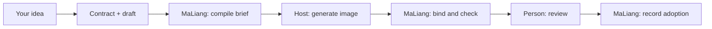

# MaLiang

[English](README.md) | [简体中文](README.zh-CN.md)

**Turn game-art ideas into precise requests, then track exactly which image was
checked, reviewed, and adopted.**

MaLiang is a small Python toolkit. It does **not** draw: your host (an Agent app
with an image tool, or your own script) generates images. MaLiang handles the
paperwork around that step.

| MaLiang does | MaLiang does not |
| --- | --- |
| Validate your character brief and compile it to `design.json` | Call any image or LLM service, or store API keys |
| Bind the exact returned image by hash | Decide whether art looks good |
| Run technical checks and record human review and adoption | Approve anything on a person's behalf |

## How it works



Terms like contract, draft, candidate, and adoption are explained in
[concepts](docs/concepts.md).

## Quick start

You need **Windows PowerShell, Python 3.10+, and Git**. Install from current
source: the released **v0.1.0** tag does not include the `design` and `flow`
commands used in these guides.

```powershell
git clone https://github.com/cty41/maliang.git
cd maliang
python -m venv .venv
.venv\Scripts\Activate.ps1
python -m pip install .
```

Run the offline demo, which walks the whole lifecycle with stand-in data:

```powershell
python -I examples/art-pilot/scripts/offline_demo.py --project work/art-pilot/synthetic-demo-001
```

It prints JSON with `"status": "synthetic-adopted"` and writes the files under
`work/art-pilot/synthetic-demo-001`. The [getting started](docs/getting-started.md)
tutorial explains each file, then has you compile a real sample brief.

## Where to go next

- **Learn the workflow**: [getting started](docs/getting-started.md), then [concepts](docs/concepts.md).
- **Let an Agent drive it**: [Agent setup](docs/agent-setup.md). Example request: “Read the
  MaLiang skill in my checkout, help me prepare a falcon idle sprite, and stop before
  generating images so I can review the request.”
- **Run a real project**: the [production runbook](examples/art-pilot/docs/runbook.en.md).
- **Look up a command or API**: the [usage reference](docs/usage.md).
- **See examples**: [art-pilot](examples/art-pilot/README.en.md) (offline practice and curated
  falcon images) and [poet-cast](examples/poet-cast/ATTRIBUTION.md) (attributed tutorial).
- **Contribute**: [CONTRIBUTING.md](CONTRIBUTING.md) and [AGENTS.md](AGENTS.md).

## Limits worth knowing

- The demo's image and human decision are **synthetic**: not real provider execution or approval.
- The demo **refuses an existing project folder**, even an empty one; use a new suffix per run.
- Local use is verified on Windows 11 x64; CI runs on Windows Server x64 (`windows-2025`).
- Guides, the runbook, and the skill need a source checkout; the wheel does not ship them.
- Showcase images and historical feedback are not proof of current production approval.

## Background and license

MaLiang was extracted and generalized from the **Tactics artwork tooling** so other
projects can reuse its pose-proof and review workflow ([extraction record](EXTRACTED_FROM.md)).
More references: [document map](llms.txt), [security](SECURITY.md).

Code/package: [MIT](LICENSE). Poet-cast tutorial: [CC BY 4.0](examples/poet-cast/ATTRIBUTION.md).
Asset licenses: [REUSE.toml](REUSE.toml).
