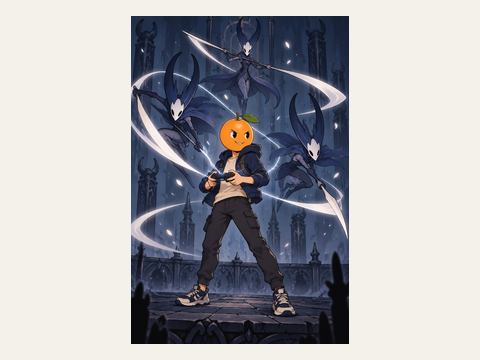

# 马良（MaLiang）

[English](README.md) | [简体中文](README.zh-CN.md)

**把游戏美术想法整理成精确的制作要求，再追踪具体哪张图片经过检查、审核和采用。**

马良是一个轻量 Python 工具包。它**不画图**：图片由你的宿主生成（带图像工具的
Agent 应用，或你自己的脚本）。马良负责这一步前后的“文书工作”。

| 马良负责 | 马良不负责 |
| --- | --- |
| 校验角色简报并编译为 `design.json` | 调用任何图像或 LLM 服务，或保存 API key |
| 通过哈希绑定实际返回的那张图 | 判断美术好不好看 |
| 执行技术检查，记录人工审核与采用 | 替任何人做批准 |

## 工作方式


图中依次是：你的想法 → 合同 + 草案 → 马良编译简报 → 宿主生图 → 马良绑定并检查 →
真人审核 → 马良记录采用。合同、草案、候选、采用等术语见[核心概念](docs/concepts.zh-CN.md)。

## 作品集

用这套流程做过的真实作品，作者 cty41（GameMancer 为 loco），CC-BY-4.0；只有小橙子走完了完整马良流程。[完整作品集与提示词概括](docs/gallery.zh-CN.md)。

| **小橙子 · Little Orange** | **游隼 · Falcon** | **亚马逊赤柴 · Red Shiba Amazon** |
|---|---|---|
|  |  |  |
| **凤头鹰 · Crested goshawk** | **五红柴诗人 · Five-red Chow Poet** | **[GameMancer](examples/gamemancer/README.zh-CN.md) · loco 作品** |
|  |  |  |

## 快速开始

需要 **Windows PowerShell、Python 3.10+ 和 Git**。请安装当前源码：已发布的
**v0.1.0** tag 不包含这些指南用到的 `design` 和 `flow` 命令。

```powershell
git clone https://github.com/cty41/maliang.git
cd maliang
python -m venv .venv
.venv\Scripts\Activate.ps1
python -m pip install .
```

运行离线演示，它用替身数据走完整个生命周期：

```powershell
python -I examples/art-pilot/scripts/offline_demo.py --project work/art-pilot/synthetic-demo-001
```

它会打印含 `"status": "synthetic-adopted"` 的 JSON，并在
`work/art-pilot/synthetic-demo-001` 下写出文件。[入门教程](docs/getting-started.zh-CN.md)
逐一解释这些文件，然后带你编译一份真实样例简报。

## 下一步去哪

- **学习流程**：[入门教程](docs/getting-started.zh-CN.md)，然后看[核心概念](docs/concepts.zh-CN.md)。
- **让 Agent 来操作**：[Agent 接入](docs/agent-setup.zh-CN.md)。请求示例：“先读我源码目录中的
  马良 skill，帮我准备一张游隼待机角色图，生图前停下来让我审核制作要求。”
- **做真实项目**：[生产运行手册](examples/art-pilot/docs/runbook.md)。
- **查命令或 API**：[使用参考](docs/usage.zh-CN.md)。
- **看例子**：[art-pilot](examples/art-pilot/README.md)（离线练习和整理后的游隼图片）和
  [poet-cast](examples/poet-cast/ATTRIBUTION.md)（带署名的教程）。
- **参与开发**：[CONTRIBUTING.md](CONTRIBUTING.md) 和 [AGENTS.md](AGENTS.md)。

## 需要知道的限制

- 演示中的图片和人工决定都是**合成数据**，不是真实服务调用或人工批准。
- 演示**拒绝已存在的项目目录**，空目录也不例外；每次运行请换新后缀。
- 本地使用在 Windows 11 x64 验证；CI 运行在 Windows Server x64（`windows-2025`）。
- 指南、运行手册和 skill 需要源码 checkout，wheel 不携带它们。
- 展示图片和历史反馈不等于当前生产批准证据。

## 来源与许可

马良从 **Tactics 的美术工具**中提取并通用化，让其他项目也能复用姿态草图和审核流程
（[提取记录](EXTRACTED_FROM.md)）。更多参考：[文档导航](llms.txt)、[安全说明](SECURITY.md)。

代码与发行包：[MIT](LICENSE)。poet-cast 教程：[CC BY 4.0](examples/poet-cast/ATTRIBUTION.md)。
素材许可：[REUSE.toml](REUSE.toml)。
