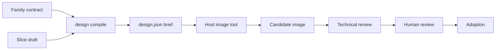

# MaLiang concepts

[English](concepts.md) | [简体中文](concepts.zh-CN.md) | [Quick start](../README.md)

Read this page once before your first real project. Each term below appears in
commands, records, or the [runbook](../examples/art-pilot/docs/runbook.en.md).

## The big picture

MaLiang does the **paperwork** around game art: it turns your decisions into a
precise request, then records exactly which image came back, what was checked,
and who approved it. Drawing the image is someone else's job.

## Who does what

- **Host**: the Agent app, IDE, or script you run (for example a coding Agent
  with an image tool). It owns the LLM, image generation/editing, and login.
- **Provider**: the actual image service the host calls. MaLiang never calls it
  and stores no API keys.
- **MaLiang**: validates inputs, compiles the brief, and writes immutable records.
- **Human reviewer**: a real person who looks at the exact image and decides.
  An Agent or a test fixture cannot play this role.

## Inputs you write

- **Family contract** (`--contract`): rules shared by a family of characters,
  such as allowed shapes, camera, and target sizes. Schema:
  [art-family-contract.schema.json](../schemas/v1/art-family-contract.schema.json).
- **Slice draft** (`--draft`): one concrete request inside that family, such as
  "falcon, idle, these views". Schema:
  [sprite-slice-draft.schema.json](../schemas/v1/sprite-slice-draft.schema.json).
- **References**: optional existing images declared by path, hash, and role.
  MaLiang records the declaration only; it does not read or copy them. An empty
  list is fine for drawing from scratch.

## Outputs MaLiang writes

- **Brief / packet** (`design.json`): the compiled execution brief, containing the
  prompt, view/state tasks, target sizes, ordered `imageInputs`, and pending
  acceptance checks. It is a request, not an image and not an approval.
- **Debug guides** (`guides/*.png`, only with `--debug-geometry`): layout
  diagrams labeled unapproved and never sent as generation input.
- **Records**: JSON files for invocation, delivery, failure, review, and
  adoption, validated against [schemas/v1](../schemas/v1).

## Production lifecycle

- **Prepare**: freeze the brief and parameters into an attempt before anything
  runs externally.
- **Candidate**: an image the host actually returned, bound to the attempt by
  its SHA-256 hash. A mismatched or hand-written result is rejected.
- **Technical review**: automatic checks on that exact candidate, such as size
  and format targets.
- **Human review**: a real decision recorded from a decision file.
- **Adoption**: marks the reviewed candidate as the current asset. It requires
  a passing technical review and a real human review.

## Safety words

- **Asset project root** (`--project`): a separate folder for one art project's
  records and images, for example a fresh folder under `work/art-pilot/`. It is
  not the MaLiang source checkout.
- **Immutable publication**: a written file is never silently overwritten.
  Rerunning identical work succeeds; different bytes at the same path fail.
- **Synthetic**: generated test data, such as the offline demo's image and
  human fixture. It proves the plumbing works, not that art was made or approved.

Next: [getting started](getting-started.md), [Agent setup](agent-setup.md), or the
[usage reference](usage.md).
