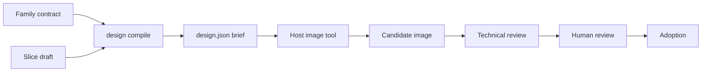

# 马良核心概念

[English](concepts.md) | [简体中文](concepts.zh-CN.md) | [快速入门](../README.zh-CN.md)

第一次做真实项目前，先把这页读一遍。下面的术语会出现在命令、记录和
[运行手册](../examples/art-pilot/docs/runbook.md)中。

## 全局视角

马良负责游戏美术周边的**“文书工作”**：把你的决定整理成精确的制作要求，
再记录具体返回了哪张图、做了哪些检查、由谁批准。画图本身由别人负责。

## 谁负责什么

- **宿主（host）**：你运行的 Agent 应用、IDE 或脚本（例如带图像工具的编程 Agent）。
  LLM、生图/编辑和登录都归它管。
- **服务商（provider）**：宿主实际调用的图像服务。马良从不调用它，也不保存 API key。
- **马良**：校验输入、编译简报、写入不可变记录。
- **人工审核人**：查看具体图片并作决定的真人。Agent 和测试数据都不能扮演这个角色。

## 你需要编写的输入

- **家族合同（family contract，`--contract`）**：同一家族角色共用的规则，
  例如允许的形体、相机和目标尺寸。Schema：
  [art-family-contract.schema.json](../schemas/v1/art-family-contract.schema.json)。
- **切片草案（slice draft，`--draft`）**：该家族内的一个具体需求，
  例如“游隼、待机、这些视图”。Schema：
  [sprite-slice-draft.schema.json](../schemas/v1/sprite-slice-draft.schema.json)。
- **参考图（references）**：可选，按路径、哈希和用途声明的已有图片。
  马良只记录声明，不读取也不复制。从零开始画时可以留空。

## 马良写出的产物

- **简报 / packet（`design.json`）**：编译后的执行简报，包含 prompt、视图/状态任务、
  目标尺寸、有序的 `imageInputs` 和待完成的验收项。它是请求，不是图片，也不是批准。
- **调试导引图（`guides/*.png`，仅在 `--debug-geometry` 时生成）**：标记为未批准的
  布局示意，绝不作为生图输入。
- **记录（records）**：调用、交付、失败、审核和采用的 JSON 文件，按
  [schemas/v1](../schemas/v1) 校验。

## 生产生命周期

- **准备（prepare）**：外部执行前，把简报和参数冻结为一次尝试（attempt）。
- **候选（candidate）**：宿主实际返回的图片，通过 SHA-256 哈希绑定到该尝试。
  不匹配或手写伪造的结果会被拒绝。
- **技术审核（technical review）**：对这张候选图执行的自动检查，例如尺寸和格式目标。
- **人工审核（human review）**：从决定文件记录的真实人工决定。
- **采用（adoption）**：把审核过的候选设为当前资产。需要技术审核通过，并有真实人工审核。

## 安全相关术语

- **资产项目根目录（asset project root，`--project`）**：单个美术项目存放记录和图片的
  独立目录，例如 `work/art-pilot/` 下的新目录。它不是马良源码目录。
- **不可变发布（immutable publication）**：已写出的文件不会被悄悄覆盖。
  相同内容重复执行成功；同一路径写入不同内容会失败。
- **合成（synthetic）**：生成的测试数据，例如离线演示中的图片和人工审核测试记录。
  它证明流程能跑通，不证明画过图或获得过批准。

下一步：[入门教程](getting-started.zh-CN.md)、[Agent 接入](agent-setup.zh-CN.md)或
[使用参考](usage.zh-CN.md)。
