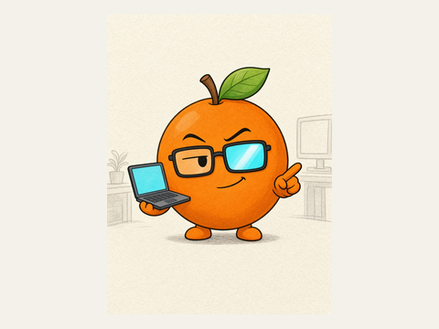
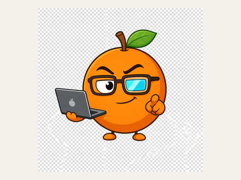
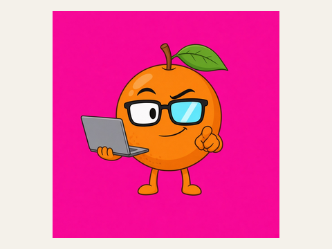
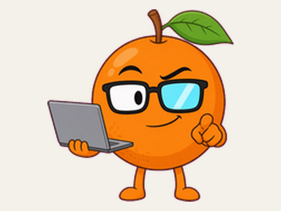
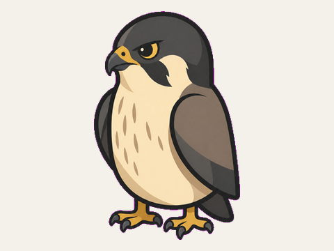
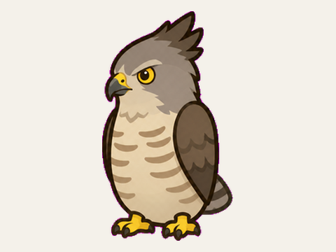
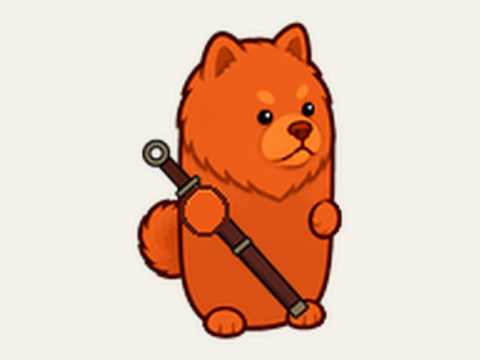
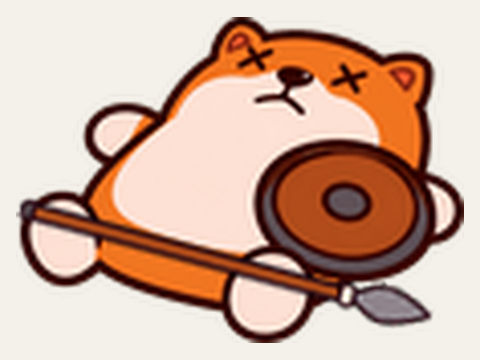

# 作品集

[返回 README](../README.zh-CN.md) · [English](gallery.md)

作品作者 **cty41**，许可 CC-BY-4.0。缩略图是展示副本（[生成方式](gallery/ATTRIBUTION.md)），
原图和记录在各示例里。被拒的尝试也特意保留。只有小橙子走完了完整马良流程；鸟类、诗人和亚马逊都早于它。

## 小橙子：一步一步

从一句话到采用的精灵图。每一步都是真实的人工或技术决定，不是动画。
[完整过程](../examples/little-orange/README.zh-CN.md)。

| **1 · 原画 v2 · 批准** | **2 · 第一次生成 · 被拒** | **3 · 品红底 · 技术检查失败** | **4 · 抠图精灵图 · 采用** |
|---|---|---|---|
|  |  |  |  |
| 线稿风，橙子就是身体 | 画出了假棋盘格，有水果标志 | JPEG 没有透明通道，符合预期 | `matte-resize` 到 256，透明检查通过 |

## 作品

| | |
|---|---|
|  |  |
| **小橙子 · Little Orange** 正面 Q 版精灵图 · 线稿平涂 提示词概括：整个身体就是卡通橙子，只有很小的 Q 版手脚；呆毛似的叶子，方框眼镜带一块青色反光，歪嘴坏笑，一手托笔记本，另一手指向观众；没有帽衫、文字和标志；纯品红背景便于抠图。原文见 `design/design.json` 的 `prompt` 字段。[示例](../examples/little-orange/README.zh-CN.md) | **游隼 · Falcon** 待机鸟类精灵图 · 品红底 内容概括（当时的提示词未保留）：真鸟拓扑配紧凑胶囊躯干，双翼收拢贴体，两脚落在脚底基线，短尾。[art-pilot](../examples/art-pilot/README.md) |
|  |  |
| **凤头鹰 · Crested goshawk** 待机鸟类精灵图 · 品红底 内容概括（当时的提示词未保留）：带羽冠的头部，横纹胸羽，双翼收拢，与游隼同一套胶囊躯干。[art-pilot](../examples/art-pilot/README.md) | **五红柴诗人 · Five-red Chow Poet** 等距待机精灵图，朝右下 · Tactics 内容概括：手持环首刀的红色松狮犬诗人；姿势先用火柴人方案比选再定。[poet-cast](../examples/poet-cast/README.md) |
|  | |
| **亚马逊赤柴 · Red Shiba Amazon** 正式版死亡精灵图 · Tactics 内容概括（没有找到提示词历史）：红柴犬亚马逊/猎手倒地，眼睛画成叉，长矛和圆盾落在身旁；胶囊身体，只有脚爪，没有四肢。[tactics-amazon](../examples/tactics-amazon/ATTRIBUTION.md) | |

展示图不代表当前的生产批准。
