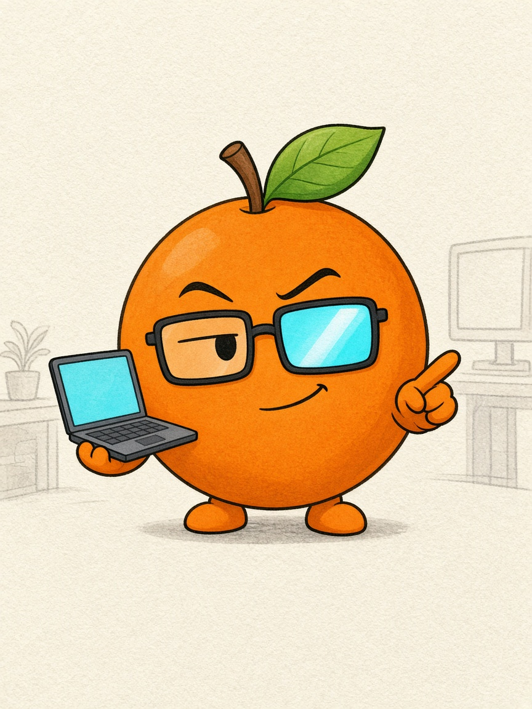
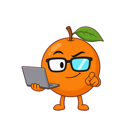
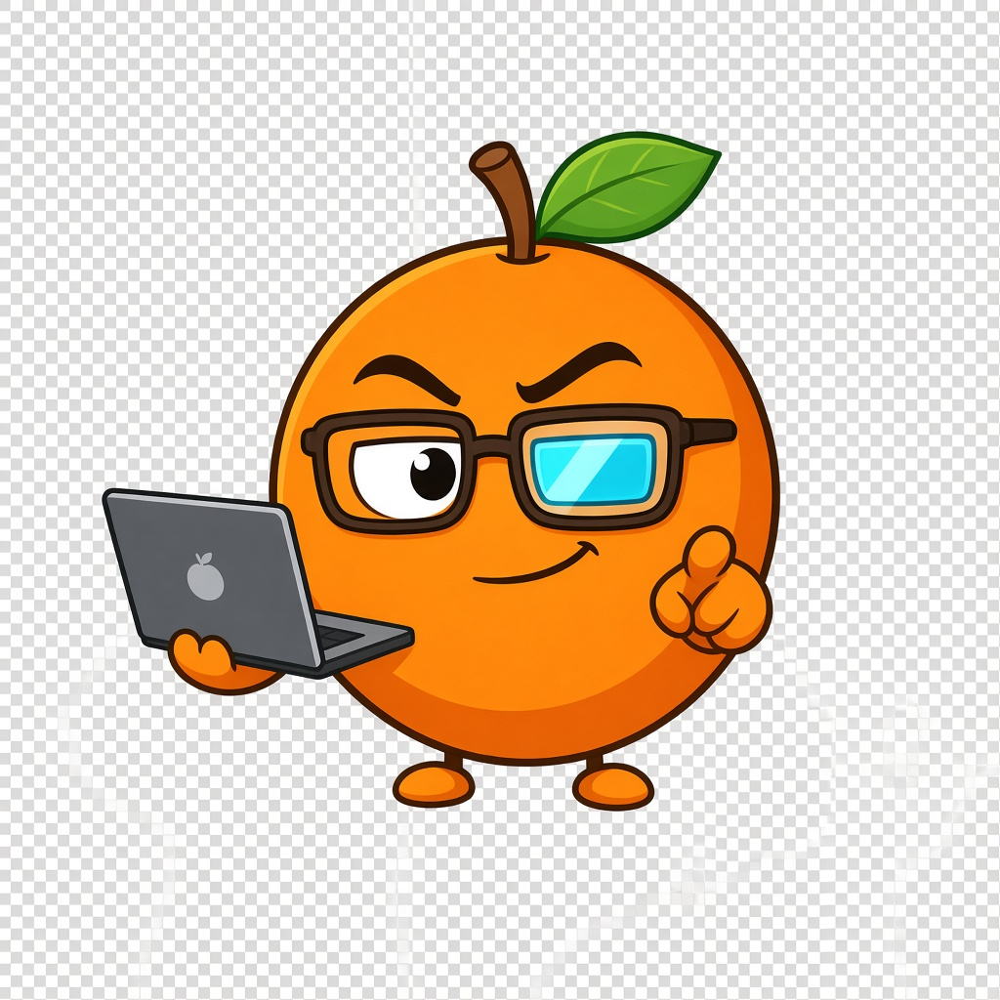
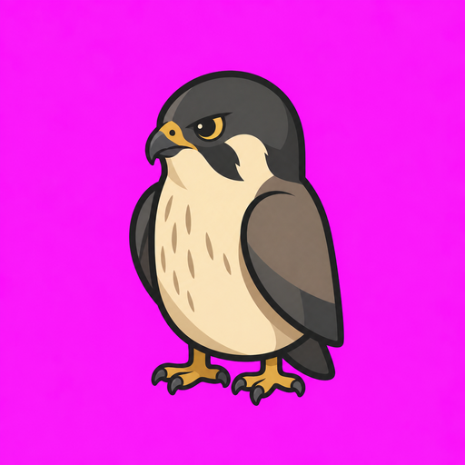
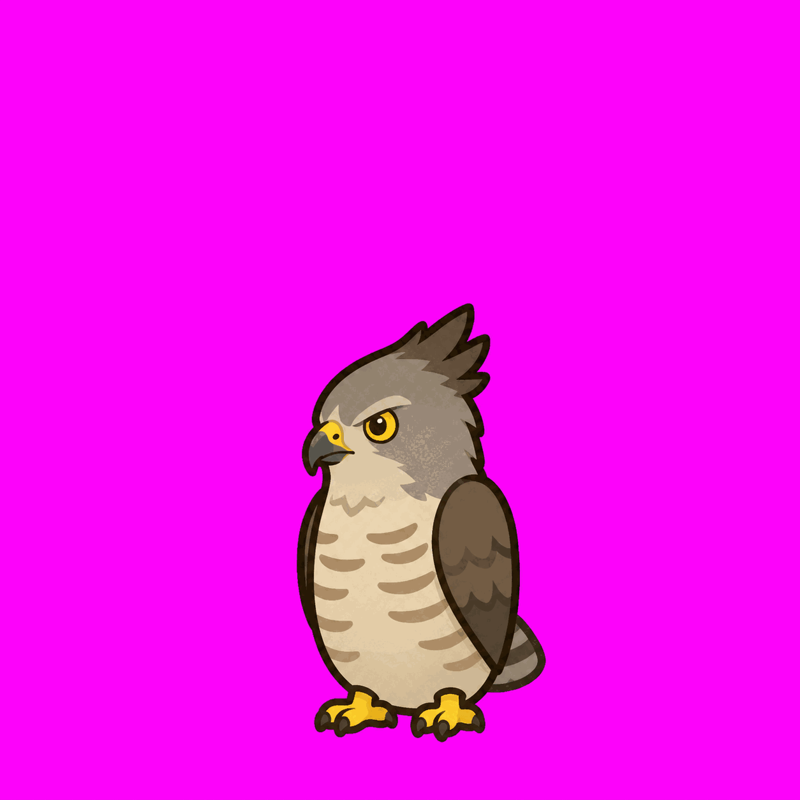
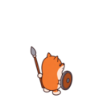
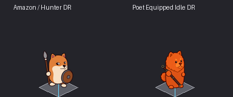

# 作品集

[返回 README](../README.zh-CN.md)

以下是用这套流程做过的真实作品。提示词只是概括，完整原文见各自链接。所有图片作者为
cty41，许可 CC-BY-4.0（详见各示例的 `ATTRIBUTION.md`）。被拒的尝试也特意保留。

**小橙子**（[完整过程](../examples/little-orange/README.zh-CN.md)）：用户只说了
“画一个小橙子 agent，它是程序员，快乐又毒舌”。走马良流程、真人审核，再抠图成 256 的透明精灵图。

<table><tr>
<td align="center"> 原画 v2（已批准）</td>
<td align="center"> 已采用的精灵图</td>
<td align="center"> 第一次尝试（被拒）</td>
</tr></table>

提示词概括：整个身体就是一个卡通橙子，只有很小的 Q 版手脚；干净线稿加平涂；叶子像呆毛一样歪着，
方框眼镜带一块青色反光，歪嘴坏笑；一只手托开着的笔记本，另一只手指向观众；没有帽衫、文字和标志。
生产版额外要求纯品红背景，便于抠出真正的透明通道。原文见
`examples/little-orange/design/design.json` 的 `prompt` 字段。

**游隼与凤头鹰**（[art-pilot](../examples/art-pilot/README.md)）：两张入选的鸟类精灵图，
512 像素、品红底，在这套流程正式化之前做的。

<table><tr>
<td align="center"> falcon-idle</td>
<td align="center"> crested-goshawk-idle</td>
</tr></table>

内容概括（当时的提示词未保留）：真鸟的拓扑结构配紧凑的胶囊躯干，双翼收拢贴体，
两脚落在脚底基线，短尾。署名文件记录的是挑选过程，不是还原出来的生成链。

**亚马逊赤柴**（[tactics-amazon](../examples/tactics-amazon/ATTRIBUTION.md)）：
来自 Tactics 游戏项目的审核图，未作修改。

<table><tr>
<td align="center"> 亚马逊，朝左上</td>
<td align="center"> 亚马逊与诗人的地块对比</td>
</tr></table>

内容概括（没有找到提示词历史）：Q 版红柴犬战士，持长矛和圆盾，为等距地块视角绘制。
这些是审核图，不是最终主视觉。

鸟类和亚马逊都早于马良流程；只有小橙子是走完整流程做出来的。
