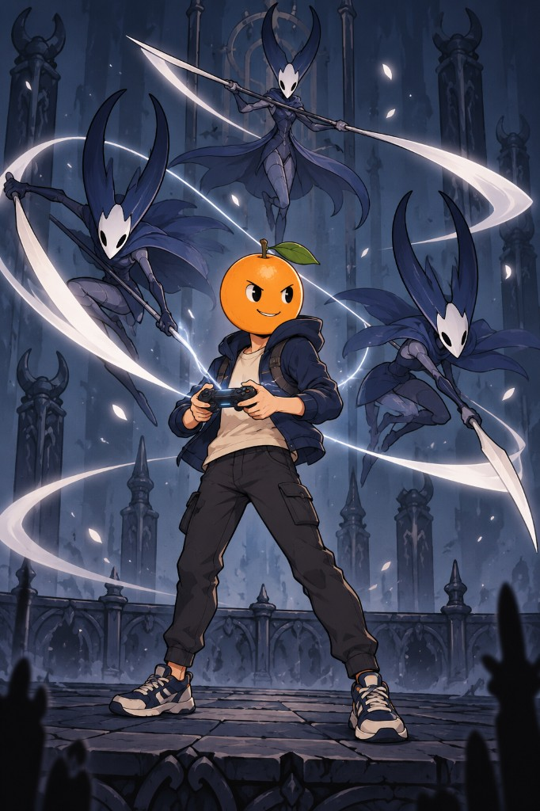

# GameMancer: Orange-Head Player vs. Hollow Knight Fighters

[简体中文](README.zh-CN.md)

A single illustration by **loco**, licensed CC-BY-4.0, made in Cursor with a
request to run the MaLiang flow and have the user review the requirements
before any image is generated. This sample keeps only the delivered image and a
text summary of the request. The project records are not part of this
repository, so this is not evidence of provider execution or human approval,
and it is not a production candidate: it is one static picture, with no pose
set, no animation, and no matted sprite.

## The request

The user asked MaLiang to make a new character through the real image flow,
with the requirements reviewed first, and set the character:

- GameMancer can borrow characters, scenes, and mechanics from games they love
  and use them to fight other people.
- The body is a human with an orange for a head.
- The borrowed game should be a well-known indie game, such as Hollow Knight.

## The result

An orange-headed player with a game controller stands on a stone ledge in a
dark gothic hall. Three pale-masked, horned Hollow Knight style fighters circle
with long needles, trailing white soul-light slashes.

Credit: image by loco, CC-BY-4.0. Hollow Knight is a trademark of its owners;
this is fan-style artwork and not affiliated with them.